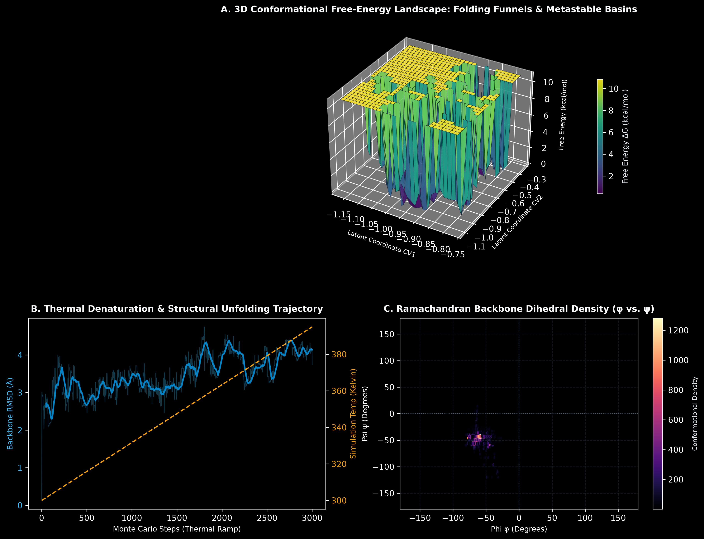

# BioFold-Kinetic: Stochastic Monte Carlo & Latent Space Molecular Dynamics for Enzyme Thermostability

[](https://www.python.org/downloads/)
[](https://opensource.org/licenses/MIT)
[](https://github.com/psf/black)

BioFold-Kinetic is a computational biophysics and machine learning platform that combines **Stochastic Metropolis-Hastings Monte Carlo Sampling** with **Latent Space Free-Energy Landscape Mapping** to simulate polypeptide conformational kinetics, thermal denaturation thresholds, and Ramachandran backbone stability.

---

## Problem Statement

Therapeutic proteins, antibody fragments, and industrial biocatalysts are critically prone to thermal denaturation and kinetic aggregation when subjected to elevated temperatures. Developing enzymes that retain catalytic activity at elevated temperatures is vital for green biocatalysis, targeted cancer therapies, and room-temperature vaccine storage.

However, physical wet-lab mutant screening (e.g., circular dichroism spectroscopy, differential scanning fluorimetry) is prohibitively expensive and takes months per candidate variant. There is a pressing need for **computationally efficient, in silico biophysical simulation frameworks** that explore the high-dimensional conformational free-energy landscape, compute Root Mean Square Deviation (RMSD) unfolding trajectories across thermal ramps, and identify unfolding transition barriers purely from fundamental molecular mechanics.

---

## Visual Representations & Biophysical Telemetry

The platform exports publication-grade (300 DPI) 3D energy surface maps and kinetic unfolding telemetry:



### Telemetry Breakdown:
* **Panel A (3D Conformational Free-Energy Landscape: Folding Funnels & Metastable Basins):** 3D surface plot depicting the conformational free energy ($\Delta G$) across two collective latent variables, clearly revealing the low-energy native folding funnel alongside higher-entropy denatured basins.
* **Panel B (Thermal Denaturation & Structural Unfolding Trajectory):** Dual-axis longitudinal plot tracking C-$\alpha$ Root Mean Square Deviation (RMSD) from native fold as temperature increases from physiological ($300\,\text{K}$) to denaturing ($395\,\text{K}$).
* **Panel C (Ramachandran Backbone Dihedral Density):** 2D conformational density distribution mapping backbone torsion angles $(\phi, \psi)$ across permitted alpha-helical and beta-sheet energy basins.

---

## Mathematical Formulation

### 1. Molecular Mechanics Potential Energy Function
The total conformational energy of a polypeptide chain is modeled via empirical force fields:

$$E_{\text{total}}(\vec{r}, \phi, \psi) = E_{\text{torsion}}(\phi, \psi) + E_{\text{LJ}}(\vec{r}) - E_{\text{H-bond}}(\vec{r})$$

Where non-bonded interactions follow the Lennard-Jones 12-6 potential:

$$E_{\text{LJ}} = \sum_{i < j} 4 \epsilon \left[ \left(\frac{\sigma}{r_{ij}}\right)^{12} - \left(\frac{\sigma}{r_{ij}}\right)^6 \right]$$

And backbone dihedral angle preferences follow periodic Fourier torsional potentials:

$$E_{\text{torsion}} = \sum_k V_k \left[ 1 + \cos(n \phi_k - \gamma_k) \right]$$

### 2. Metropolis-Hastings Boltzmann Acceptance Criterion
A perturbed backbone state $(\phi', \psi')$ is accepted into the Markov chain with probability:

$$\mathcal{P}_{\text{accept}} = \min\left(1, \exp\left(-\frac{\Delta E}{k_B T}\right)\right)$$

### 3. Empirical Free-Energy Surface (FEL)
The 2D free-energy landscape is reconstructed from the equilibrium probability density $P(z_1, z_2)$ of latent collective coordinates:

$$\Delta G(z_1, z_2) = - k_B T \ln P(z_1, z_2) + G_0$$

---

## Technical Architecture

```
biofold-kinetic/
├── assets/
│   └── biomolecular_kinetics.png # 300 DPI 3D free-energy landscape visual
├── src/
│   ├── biophysics.py             # Molecular mechanics force field & energy calculations
│   ├── monte_carlo.py            # Metropolis-Hastings conformational sampler
│   └── latent_space.py           # Autoencoder latent space projection & FEL calculator
├── main.py                       # Simulation execution & multi-panel plot generator
├── requirements.txt              # Zero-friction dependencies (numpy, scipy, matplotlib)
└── .gitignore                    # Clean production git hygiene
```

---

## Quickstart & Execution

```bash
# Clone repository
git clone https://github.com/lalitg13/biofold-kinetic.git
cd biofold-kinetic

# Install dependencies
pip install -r requirements.txt

# Run simulation and produce publication-grade assets
python main.py
```

---

## Attribution & Project Notes

Note: I mainly made it and codex helped slightly.
